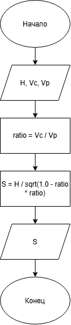

# Домашнее задание к работе 2

## Условие задачи

Самолет летит по прямой на высоте H метров со скоростью Vc м/с. В момент его прохождения над зенитной пусковой установкой по нему выпускается ракета со скоростью Vp м/с. Считая, что до места встречи ракета летит по прямой и радиус ее действия бесконечен, определить S — дальность поражения цели от пусковой установки.

## 1. Алгоритм и блок-схема

### Алгоритм

1. **Начало.**
2. Задать исходные данные:
   - `H` — высота самолета в метрах.
   - `Vc` — скорость самолета в метрах в секунду.
   - `Vp` — скорость ракеты в метрах в секунду.
3. Найти отношение скорости самолета к скорости ракеты:
   - `ratio = Vc / Vp`
4. Определить дальность поражения `S`:
   - `S = H / sqrt(1.0 - ratio * ratio)`
5. Вывести результат расчета с подстановкой всех значений.
6. **Конец.**

### Блок-схема



## 2. Реализация программы

```c
#include <math.h>
#include <stdio.h>
#include <locale.h>

int main() {
    setlocale(LC_CTYPE, "");

    float H = 10000; // Высота
    float Vc = 230;  // Скорость самолета
    float Vp = 700;  // Скорость ракеты

    float ratio = Vc / Vp;
    float S = H / sqrt(1.0 - ratio * ratio); // Расчет S

    printf("Дальность поражения цели от пусковой установки S = %.2f метров.\n", S);

    return 0;
}
```

## 3. Результаты работы программы

Дальность поражения цели от пусковой установки S = 10587.85 метров.

## 4. Информация о разработчике

Измалком Илья бИД-261
